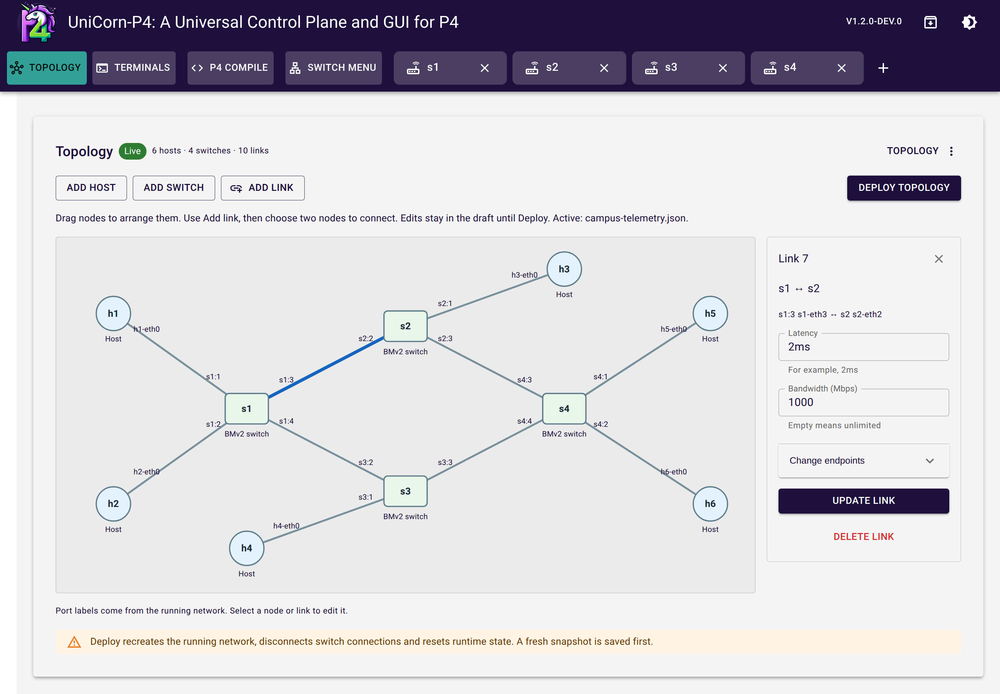
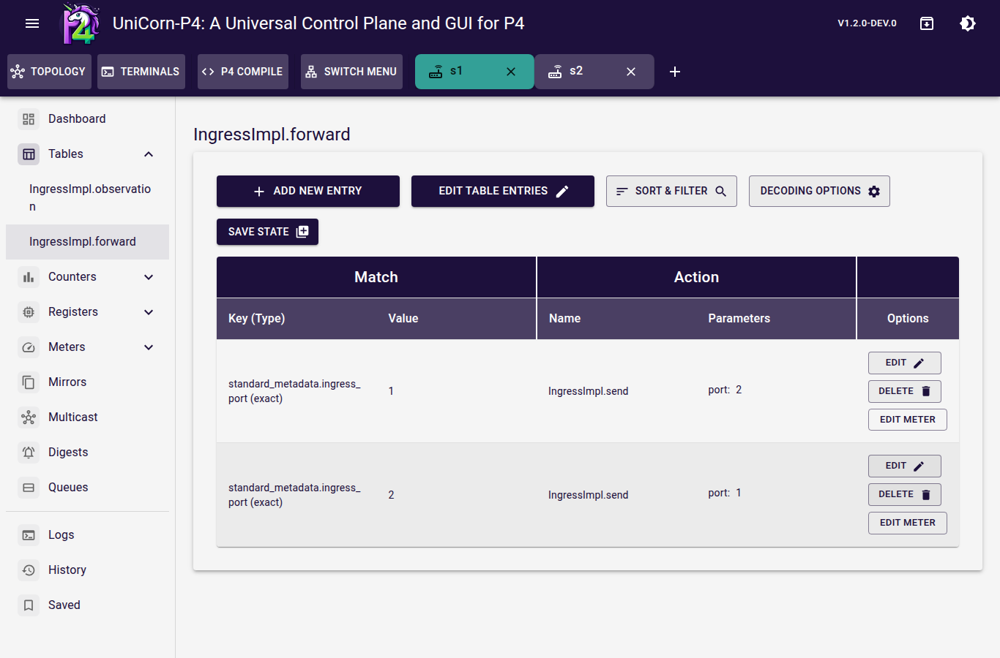
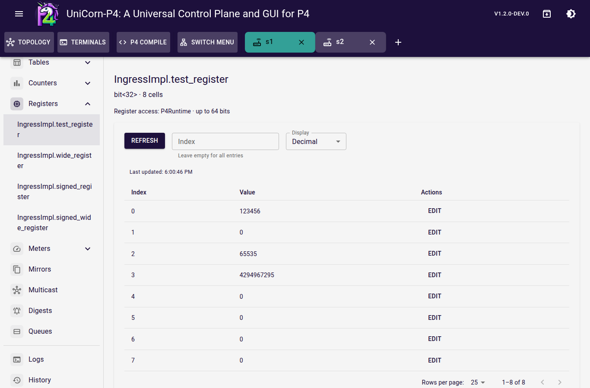
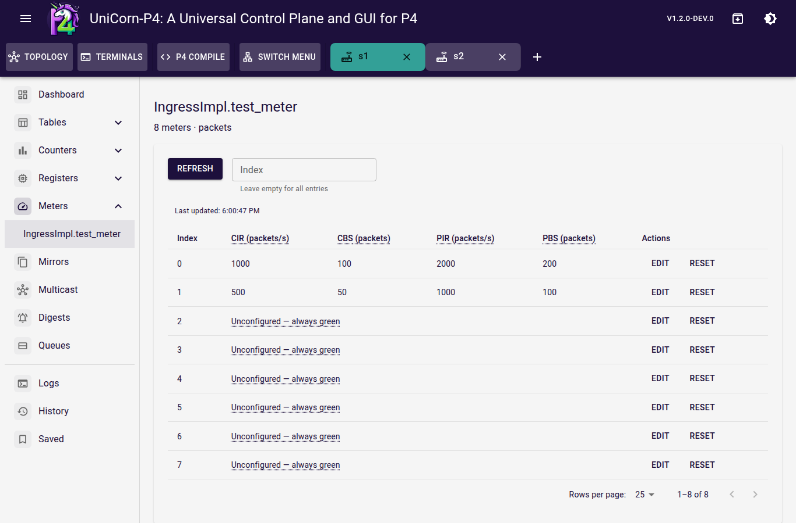
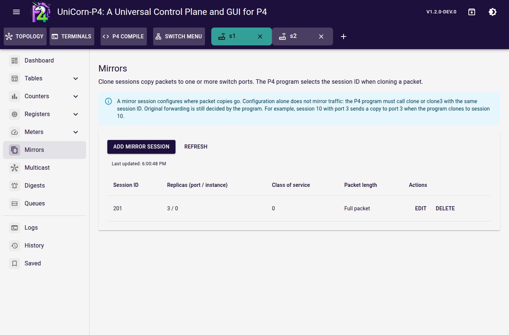
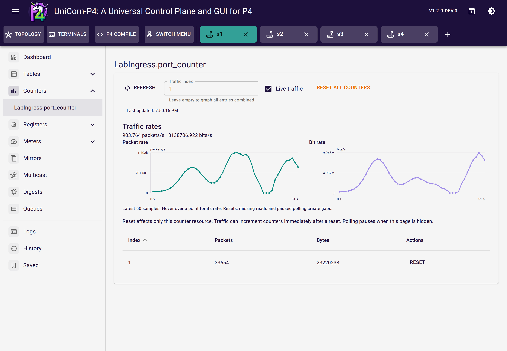
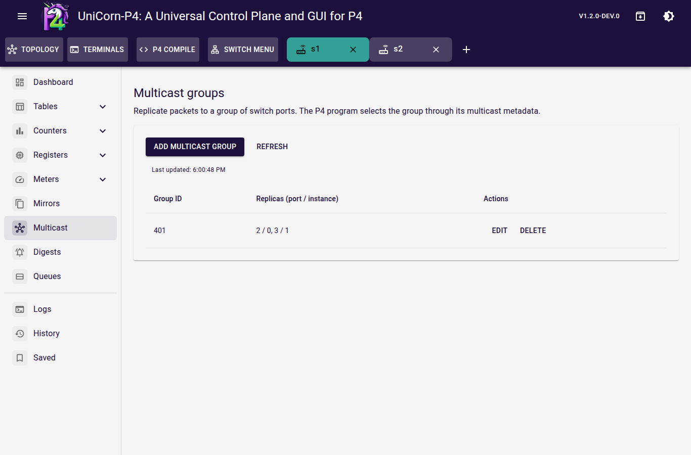
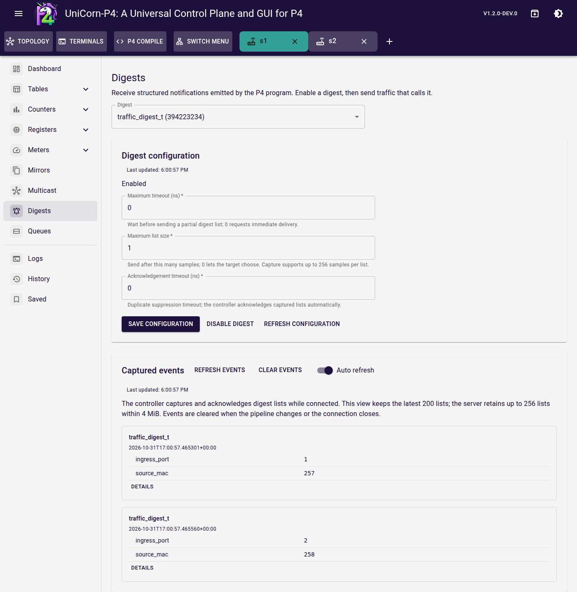
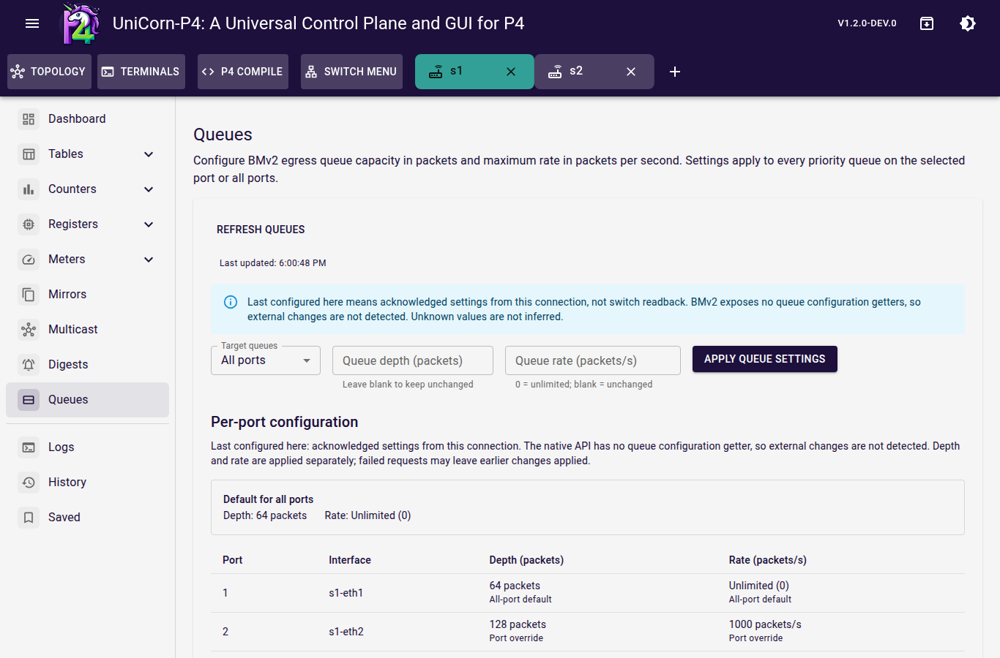

<p align="center">
  
</p>

<h1 align="center">UniCorn-P4</h1>

<p align="center">
  A browser-based P4 development platform: program switches, inspect state, and build emulated networks.
</p>

<p align="center">
  <a href="https://github.com/uni-tue-kn/UniCorn-P4/actions/workflows/docker-image.yml"></a>
  
  
  
  <a href="LICENSE"></a>
</p>

<p align="center">
  
</p>

## From P4 program to running network

- **Edit and compile P4** with a browser editor, completion and diagnostics.
- **Build networks** with a visual Mininet editor and host/switch terminals.
- **Connect switches** using BMv2, optional Tofino models, or external devices.
- **Program resources** including tables, registers, meters, mirror sessions and multicast groups.
- **Inspect traffic** with counters, throughput plots, digests and queue controls.
- **Export/import networks** with their topology, programs and captured switch state.

<table>
  <tr>
    <td></td>
    <td></td>
  </tr>
  <tr>
    <td align="center"><strong>Match-action tables</strong></td>
    <td align="center"><strong>Lossless register values</strong></td>
  </tr>
  <tr>
    <td></td>
    <td></td>
  </tr>
  <tr>
    <td align="center"><strong>Meters and direct meters</strong></td>
    <td align="center"><strong>Mirror sessions</strong></td>
  </tr>
</table>

<details>
  <summary><strong>Traffic and control-plane tools</strong></summary>
  <br>
  
  
  
  
</details>

_The topology and throughput screenshots show the campus telemetry example with real emulated traffic._

Also available in dark mode: [topology](docs/screenshots/topology-dark.png) · [throughput](docs/screenshots/counters-dark.png).

## Quick start

You need Linux and Docker with Compose v2.

```sh
git clone https://github.com/uni-tue-kn/UniCorn-P4.git
cd UniCorn-P4/docker
docker compose pull
docker compose up -d
```

Open http://localhost:3000. Put P4 files in `docker/p4-files/` and topology JSON
in `docker/topologies/`. Compile a program, deploy a topology, then initialize a switch.

Try a [sample network bundle](examples/networks/README.md) through the global
**Network archive** menu.

Or extract a [release archive](https://github.com/uni-tue-kn/UniCorn-P4/releases)
and run the same Compose commands from its `UniCorn-P4/` folder.
Both use published `latest` images. For source changes, see
[development and tests](docs/usage.md#development-and-tests).

## Target support

BMv2 is included. The optional [Tofino setup](docs/tofino.md) adds the Open P4Studio
model and compiler. Both targets share the same resource screens.

[Usage guide](docs/usage.md) · [Physical interfaces](docs/usage.md#use-external-network-interfaces) · [Compatibility](docs/compatibility.md) · [Changelog](CHANGELOG.md)
