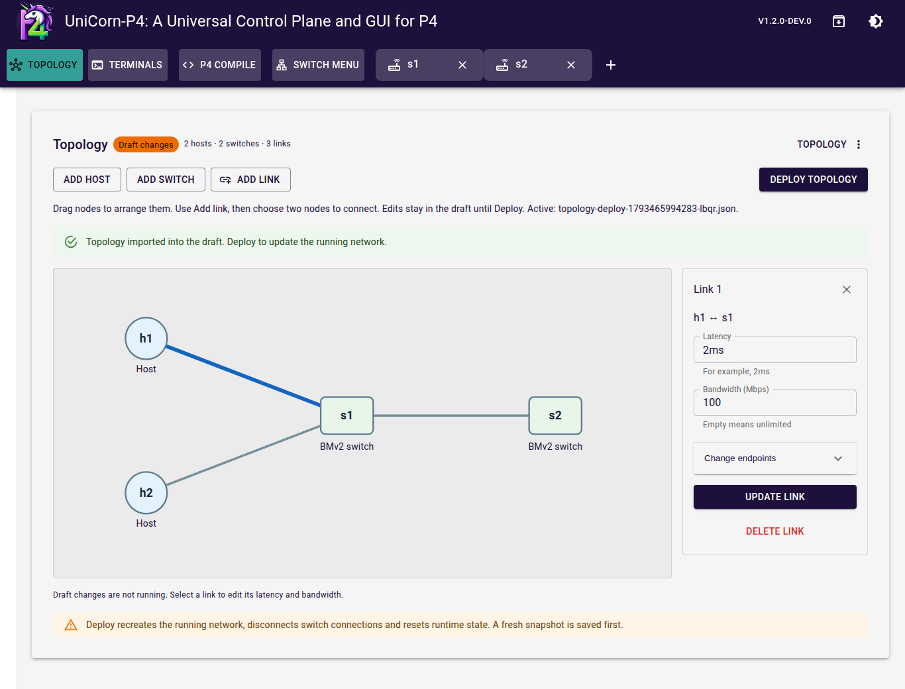
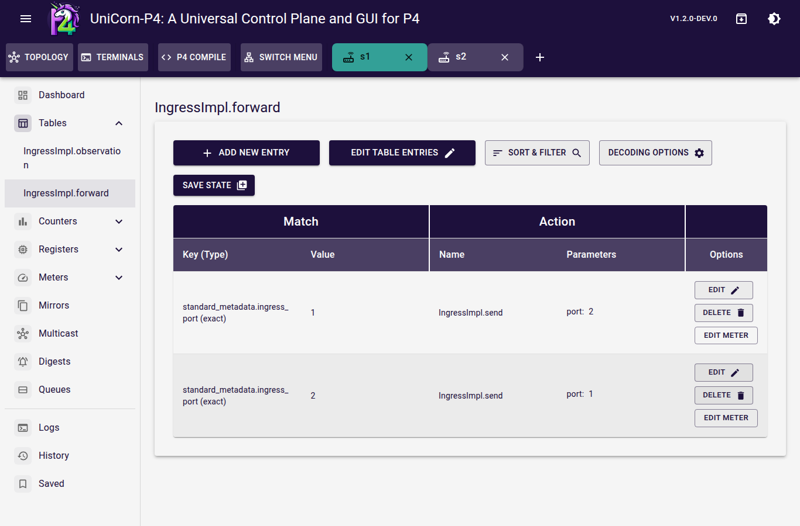
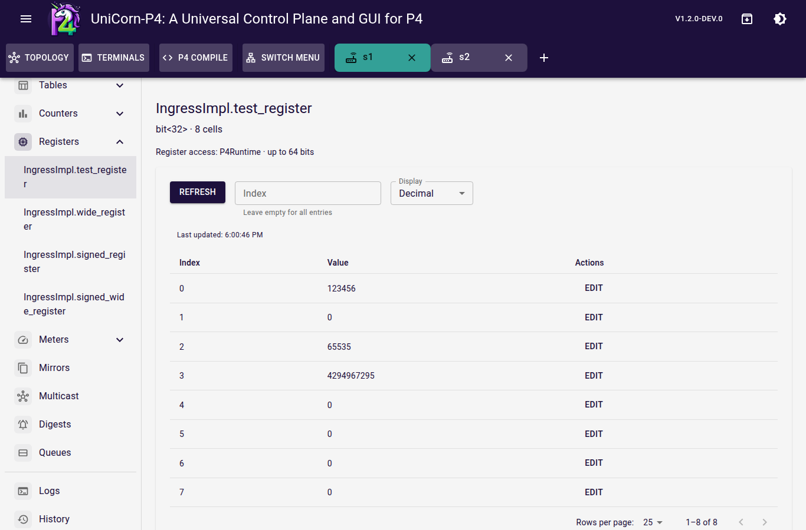
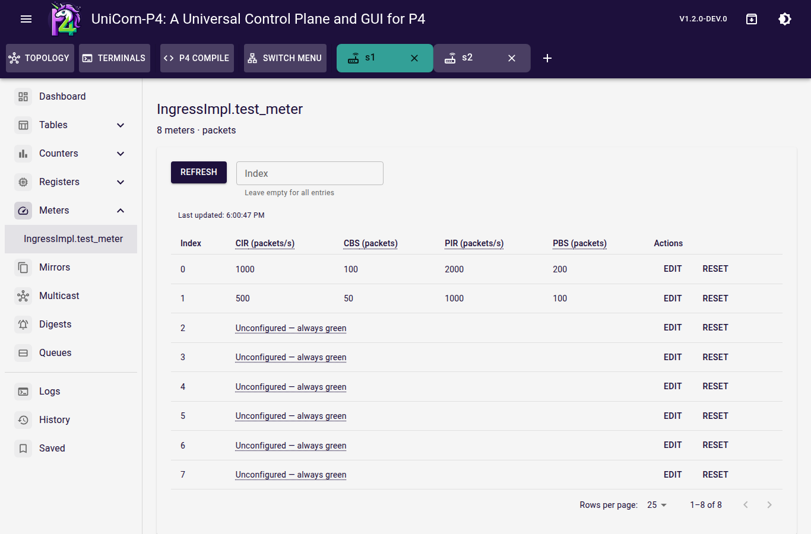
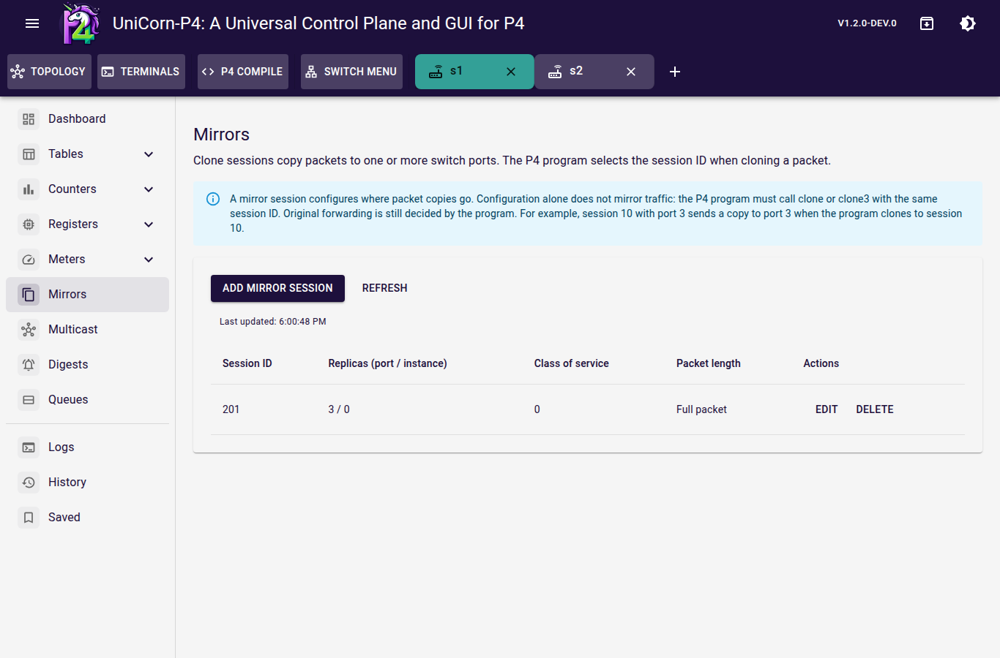
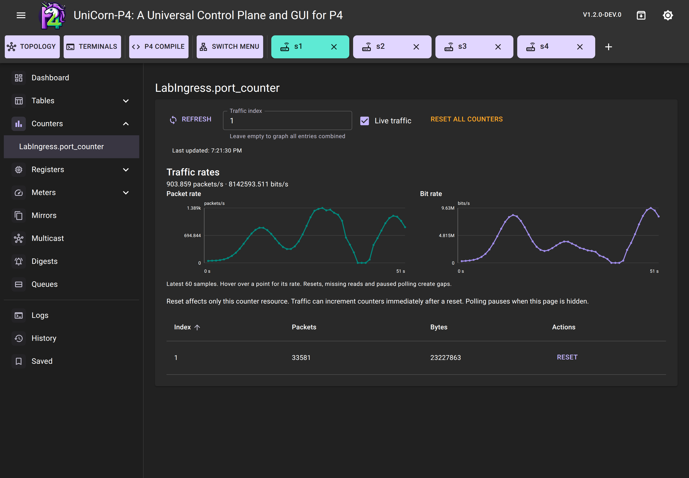
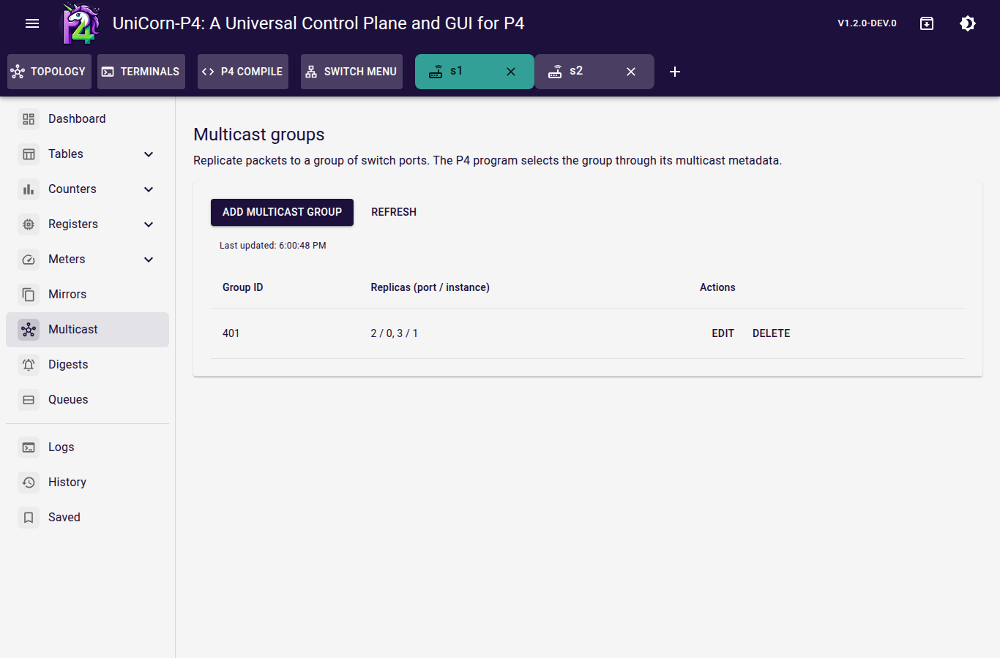
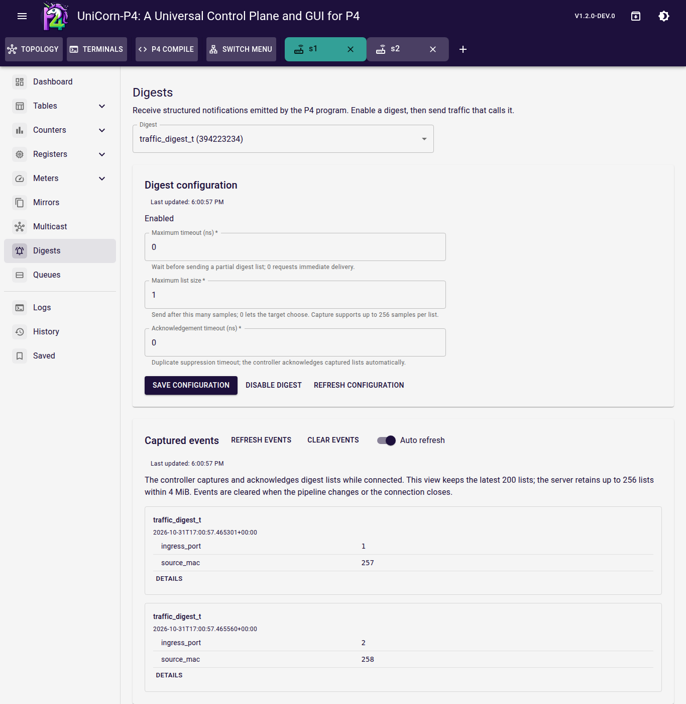
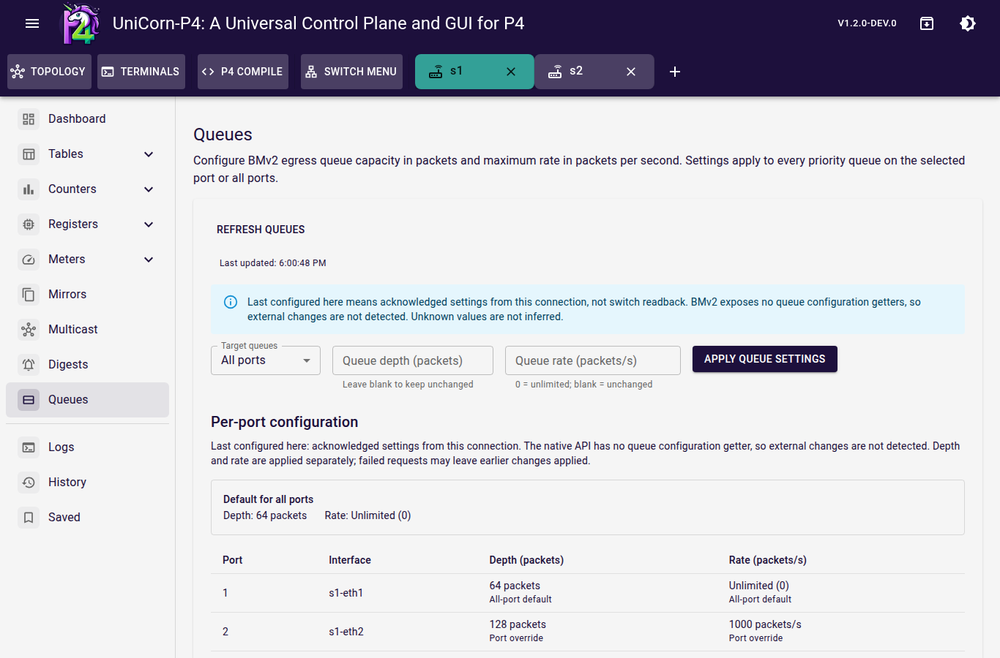

<p align="center">
  
</p>

<h1 align="center">UniCorn-P4</h1>

<p align="center">
  A browser-based P4 development platform: program switches, inspect state, and build emulated networks.
</p>

<p align="center">
  <a href="https://github.com/uni-tue-kn/UniCorn-P4/actions/workflows/docker-image.yml"></a>
  
  
  
  <a href="LICENSE"></a>
</p>

<p align="center">
  
</p>

## From P4 program to running network

- **Build and visualize networks** with Mininet, a drag-and-drop topology editor, saved layouts, interface maps, and per-node terminals.
- **Program match-action tables** discovered from P4Info, with single/bulk editing, filtering, decoding, and saved MAT snapshots.
- **Inspect live traffic** with counters, resets, traffic graphs, and digest events emitted by your program.
- **Configure registers and meters** through P4Runtime, with precise integer values and per-entry direct meters.
- **Manage packet replication** through mirror sessions and multicast groups.
- **Tune BMv2 queues** with per-port depth and packet-rate controls.

<table>
  <tr>
    <td></td>
    <td></td>
  </tr>
  <tr>
    <td align="center"><strong>Match-action tables</strong></td>
    <td align="center"><strong>Lossless register values</strong></td>
  </tr>
  <tr>
    <td></td>
    <td></td>
  </tr>
  <tr>
    <td align="center"><strong>Meters and direct meters</strong></td>
    <td align="center"><strong>Mirror sessions</strong></td>
  </tr>
</table>

<details>
  <summary><strong>Traffic and control-plane tools</strong></summary>
  <br>
  
  
  
  
</details>

_The topology and throughput screenshots show the campus telemetry example with real emulated traffic._

## Quick start

You need Linux and Docker with Compose v2.

```sh
git clone https://github.com/uni-tue-kn/UniCorn-P4.git
cd UniCorn-P4/docker
docker compose pull
docker compose up -d
```

Open http://localhost:3000. Put your P4 files in `p4-files/` and topology JSON in
`topologies/` inside the current `docker/` directory, then compile, load a topology,
and initialize a switch. This uses the published `latest` images. For local source
changes, see [development and tests](docs/usage.md#development-and-tests).

Try the [sample network bundles](examples/networks/README.md) for forwarding,
multicast, mirroring, and metering demonstrations. Import a bundle from the global network archive menu.

Published [release archives](https://github.com/uni-tue-kn/UniCorn-P4/releases) use
the same deployment layout: extract `UniCorn-P4.tar.gz`, enter `UniCorn-P4/`, and run
`docker compose pull` followed by `docker compose up -d`.

## Target support

The bundled BMv2 emulator supports scalar registers up to **64 bits** through a
P4Runtime server extension. Stock external BMv2/PI needs the explicit register
adapter, which conservatively supports up to **63 bits**. Tables, counters, meters,
and supported mirror sessions continue to use standard P4Runtime operations.

See the [usage guide](docs/usage.md) for setup, resource workflows, external switches,
testing, and releases. The [runtime notes](runtime/README.md) explain compatibility
limits. Component versions are shown in the UI and recorded in [VERSION](VERSION).
Development changes are listed in the [changelog](CHANGELOG.md).
